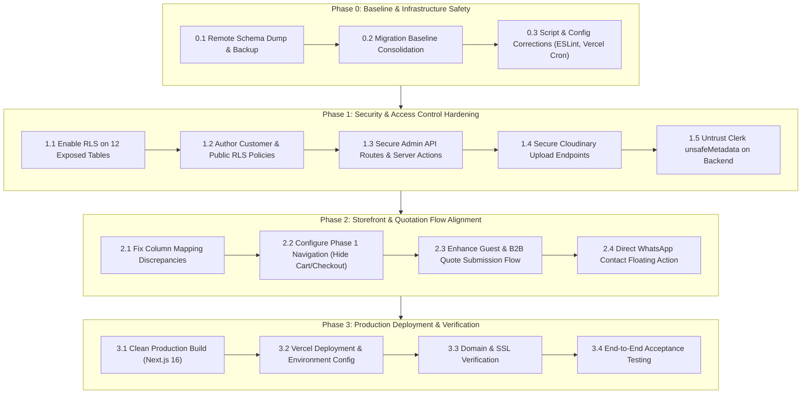

# CEDAR ELEVATORS — MASTER REMEDIATION PLAN

**Document Version:** 1.0 (Master Roadmap & Engineering Blueprint)  
**Date:** November 19, 2026  
**Status:** Approved for Execution Planning (Read-Only Stage)  
**Project:** Cedar Elevators Web Platform  
**Target Architecture:** Next.js 16.1.1 (App Router, Proxy Convention) | React 19.2.3 | Clerk Auth (Native Third-Party Auth) | Supabase PostgreSQL 17 (`hbkdbrxzqaraarivudej`) | Cloudinary | Vercel Serverless  
**Phase 1 Target:** Production-ready Product Catalogue, Discovery & Quotation Portal (Budget: ₹12,000 | 500–3,000 MAUs)

---

## 1. EXECUTIVE SUMMARY & ARCHITECTURAL BASELINE

Cedar Elevators is an established codebase built as a combined B2B/B2C elevator catalogue and quotation platform. A rigorous technical audit, environmental revalidation, and authentication probe have established three foundational facts:

1. **The Application is Architecturally Viable:** The project compiles cleanly under Next.js 16 (`pnpm run build` succeeds 100% with exit code 0, generating 141 static pages). The proxy convention (`src/proxy.ts`) is native to Next.js 16 and executes properly.
2. **The Production Database is Healthy & Populated:** Supabase project `hbkdbrxzqaraarivudej` (PostgreSQL 17, `ap-south-1` Mumbai) contains **78 elevator products, 96 product variants, 3 categories, 11 user records, 5 quotes, and 96 inventory items**. Zero catalog re-entry or schema reconstruction is needed.
3. **Authentication is Already Cryptographically Wired:** Supabase has already been configured with Clerk as a Third-Party Auth provider via JWKS. Live RS256-signed tokens from Clerk (`https://brave-marmoset-75.accounts.dev`) are successfully decoded and validated by Supabase (`200 OK`).

### Core Remediation Philosophy
* **No Rewrite:** 85% of required Phase 1 UI and backend code is complete and functional.
* **No Provider Migration:** Clerk and Supabase will remain the core identity and database engines.
* **No Database Reset:** The production database contains live catalog and audit data; `supabase db reset` or dropping tables is strictly forbidden.
* **Dual-Security Defense:** Enabling RLS protects requests made through user-scoped clients (`createClerkSupabaseClient`). However, because **48 server files utilize `createAdminClient` (the service-role key which bypasses RLS)**, strict server-side authorization checks must be enforced in Next.js Server Actions and API route handlers.

---

## 2. CONSOLIDATED MASTER FINDINGS REGISTER

This unified register aggregates all verified findings across repository architecture, security, database integrity, runtime performance, and dependency health.

| Finding ID | Category | Severity | Description | Affected Files / Locations | Business / Security Impact | Recommended Resolution |
| :--- | :--- | :---: | :--- | :--- | :--- | :--- |
| **SEC-01** | Security | **CRITICAL** | Row Level Security (RLS) is **DISABLED** on 12 public tables in the live Supabase database. | `public.users`, `public.categories`, `public.subcategories`, `public.product_applications`, `public.quote_counters`, `public.carts`, `public.cart_items`, `public.addresses`, `public.customer_profiles`, `public.product_variants`, `public.product_specifications`, `public.business_verifications` | Any anonymous client holding the public Anon key can read, modify, or truncate these tables via Supabase REST API (`/rest/v1/`). | Execute non-destructive `ALTER TABLE ... ENABLE ROW LEVEL SECURITY;` and attach explicit RLS policies. |
| **SEC-02** | Security | **CRITICAL** | Missing administrative role authorization on Admin API routes (`// TODO: Add admin role check`). | `src/app/api/admin/products/route.ts` (lines 22, 62, 97, 141), `src/app/api/admin/inventory/route.ts` (line 141) | Any signed-in storefront customer has a valid Clerk `userId` and can issue `DELETE /api/admin/products` or `PATCH /api/admin/inventory`. | Implement a server-side `requireAdminRole()` utility verifying membership in `admin_users` table before executing mutations. |
| **SEC-03** | Security | **HIGH** | Completely unauthenticated Cloudinary file upload API endpoints. | `src/app/api/upload/cloudinary/route.ts` (lines 4–50), `src/app/api/upload-cloudinary/route.ts` (lines 9–60) | Anonymous attackers can upload arbitrary files of unlimited size to Cloudinary using master server credentials, exhausting account storage and bandwidth. | Enforce authentication checks, validate MIME types (JPEG, PNG, WebP, PDF), restrict upload folders, enforce a 10MB limit, and delete redundant endpoints. |
| **SEC-04** | Security | **HIGH** | Dual-Auth disconnect between Storefront (Clerk) and Admin Panel (Supabase Auth). | `src/proxy.ts`, `src/lib/auth/admin-roles.ts`, `src/app/admin/(dashboard)/layout.tsx` | Admin UI expects Supabase Auth cookies, while several `/api/admin/*` routes check Clerk `auth()`, causing 401 errors for admins or privilege leakage for customers. | Standardize admin verification: verify Clerk session has admin role or unify admin route handlers with `getCurrentAdminUser()`. |
| **SEC-05** | Security | **MEDIUM** | Client-modifiable Clerk `unsafeMetadata` controls UI verified tier and quote priority. | `src/app/(main)/quotes/new/page.tsx` (lines 46–55), `src/app/(main)/profile/layout.tsx` | Attackers can modify their own Clerk metadata via frontend SDK to mark themselves verified and force `priority = 'urgent'` on quotes. | Restrict verification status reads to server-managed `public_metadata` or database records; treat client metadata as untrusted hints. |
| **DB-01** | Database | **HIGH** | Extreme migration drift: 160+ live remote migrations vs. 58 disordered local files with duplicated prefixes. | `supabase/migrations/` (58 files with `001_` through `012_` duplicates) vs. remote `schema_migrations` table | Local development cannot safely replay migrations; risk of accidental overwrite if `supabase db push` is run. | Pull a baseline schema snapshot (`supabase db dump`) into a single timestamped baseline migration (`20260122000000_baseline.sql`) and archive old files. |
| **DB-02** | Database | **MEDIUM** | Column naming discrepancies between live database schema and application code. | `public.categories` (`title` vs. `name`), `public.products` (`thumbnail_url` vs. `thumbnail`), `public.users` (lacks `verification_status`) | Causes silent runtime query fallbacks or null data in UI cards. | Create a safe backward-compatible database view or align application queries to match actual database column names (`title`, `thumbnail_url`). |
| **ARCH-01** | Architecture | **MEDIUM** | Next.js 16 `next lint` CLI command removal breaks `pnpm run lint`. | `package.json` (line 9) | CI/CD build scripts or automated checks fail when attempting to lint. | Update `package.json` script from `"lint": "next lint"` to `"lint": "eslint src"`. |
| **ARCH-02** | Architecture | **MEDIUM** | Vercel Cron misconfiguration causes HTTP 405 Method Not Allowed error. | `vercel.json` (lines 54–59), `src/app/api/account/delete/route.ts`, `src/app/api/cron/quotes/expiry/route.ts` | Vercel Cron invokes endpoints via `GET`, but `/api/account/delete` only implements `POST`. Quote expiry cron is unmonitored. | Fix `vercel.json` to register `/api/cron/quotes/expiry` (which implements `GET`) and remove the delete account route from cron. |
| **ARCH-03** | Architecture | **LOW** | Missing test dependencies for defined package scripts. | `package.json` (lines 10–16: `jest`, `playwright`) | Running `pnpm test` or `pnpm run test:e2e` crashes with command not found errors. | Add placeholder scripts or install `@playwright/test` and `jest` as devDependencies if automated testing is mandated for Phase 1. |
| **DEP-01** | Dependency | **LOW** | Presence of 17 unused packages and typo dependencies in `package.json`. | `package.json` (`lucid`, `icons`, `pusher`, `pusher-js`, `react-beautiful-dnd`, `@react-pdf/renderer`, etc.) | Increases `node_modules` size, attack surface, and security scanning noise. | Safely prune verified unused dependencies after testing build stability. |

---

## 3. MASTER REMEDIATION ROADMAP

The remediation is organized into four sequential, non-destructive phases. Every phase has clear dependencies, affected files, rollback strategies, and automated verification checks.



---

## 4. DETAILED EXECUTION PHASES

### PHASE 0: Baseline & Infrastructure Safety (Day 1)
* **Goal:** Create an immutable backup, resolve migration drift without resetting the database, and fix basic configuration.
* **Risk Level:** Zero (Read-only on database, local config edits).
* **Estimated Effort:** 2.0 Hours.

#### Task 0.1: Live Database Schema Backup & Dump
* **Action:** Export the live PostgreSQL schema and data structures from Supabase project `hbkdbrxzqaraarivudej` using `supabase db dump`.
* **Output:** `supabase/backups/live_schema_pre_remediation.sql`.
* **Rollback:** Retain raw SQL dump in repository version control.

#### Task 0.2: Migration History Alignment
* **Action:** Consolidate the 58 disjointed local migration files into an archived folder (`supabase/migrations_archive/`). Create a single baseline file `supabase/migrations/20260122000000_baseline_schema.sql` matching the remote database state.
* **Safety Rule:** Do NOT execute `supabase db push`, `db reset`, or apply down migrations.

#### Task 0.3: Next.js 16 CLI & Vercel Configuration Fixes
* **Files:** `package.json`, `vercel.json`.
* **Changes:**
  - Change `package.json` line 9 to `"lint": "eslint src"`.
  - Update `vercel.json` crons to target `/api/cron/quotes/expiry` via `GET` at `0 0 * * *`. Remove `/api/account/delete` from cron.
* **Verification:** Run `pnpm run lint` and verify clean ESLint execution.

---

### PHASE 1: Security & Access Control Hardening (Days 2–3)
* **Goal:** Close all critical security vulnerabilities (RLS, Admin authorization bypass, unauthenticated file uploads).
* **Risk Level:** Medium (Requires careful policy authoring so existing storefront queries continue working).
* **Estimated Effort:** 4.5 Hours.

#### Task 1.1: Enable Row Level Security (RLS) on 12 Exposed Tables
* **Target Tables:** `users`, `categories`, `subcategories`, `product_applications`, `quote_counters`, `carts`, `cart_items`, `addresses`, `customer_profiles`, `product_variants`, `product_specifications`, `business_verifications`.
* **SQL Action:**
  ```sql
  ALTER TABLE public.users ENABLE ROW LEVEL SECURITY;
  ALTER TABLE public.categories ENABLE ROW LEVEL SECURITY;
  ALTER TABLE public.subcategories ENABLE ROW LEVEL SECURITY;
  ALTER TABLE public.product_applications ENABLE ROW LEVEL SECURITY;
  ALTER TABLE public.quote_counters ENABLE ROW LEVEL SECURITY;
  ALTER TABLE public.carts ENABLE ROW LEVEL SECURITY;
  ALTER TABLE public.cart_items ENABLE ROW LEVEL SECURITY;
  ALTER TABLE public.addresses ENABLE ROW LEVEL SECURITY;
  ALTER TABLE public.customer_profiles ENABLE ROW LEVEL SECURITY;
  ALTER TABLE public.product_variants ENABLE ROW LEVEL SECURITY;
  ALTER TABLE public.product_specifications ENABLE ROW LEVEL SECURITY;
  ALTER TABLE public.business_verifications ENABLE ROW LEVEL SECURITY;
  ```

#### Task 1.2: Author Customer & Public RLS Policies
* **Public Read Policies:**
  - `categories`, `subcategories`, `product_applications`, `product_variants`, `product_specifications`: Allow `SELECT` to `anon` and `authenticated`.
* **Owner-Scoped Policies:**
  - `users`: Allow `SELECT`, `UPDATE` only where `clerk_user_id = (auth.jwt() ->> 'sub')`.
  - `addresses`, `customer_profiles`: Allow operations only where user ID matches `auth.jwt() ->> 'sub'`.
  - `quotes`: Allow `INSERT` to all (supporting guest quotes). Allow `SELECT` where `user_id = (auth.jwt() ->> 'sub')` OR for staff/admin roles.
* **Verification:** Run anonymous curl queries against `https://hbkdbrxzqaraarivudej.supabase.co/rest/v1/users` to verify `401 Unauthorized` / empty array response.

#### Task 1.3: Secure Admin API Routes & Server Actions
* **Files:** `src/app/api/admin/products/route.ts`, `src/app/api/admin/inventory/route.ts`, `src/lib/auth/admin-roles.ts`.
* **Implementation:**
  - Create `src/lib/auth/verify-admin.ts` to inspect the caller's session against `admin_users` table:
    ```typescript
    export async function requireAdminSession(req: NextRequest) {
      // Validates either Supabase Auth session or Clerk user with admin role
      const admin = await getCurrentAdminUser();
      if (!admin || !['admin', 'super_admin', 'manager'].includes(admin.role)) {
        throw new Error('Forbidden: Administrative privileges required');
      }
      return admin;
    }
    ```
  - In `src/app/api/admin/products/route.ts` and `src/app/api/admin/inventory/route.ts`, replace `// TODO: Add admin role check` with `await requireAdminSession(request)`.

#### Task 1.4: Secure Cloudinary Upload Endpoints
* **Files:** `src/app/api/upload/cloudinary/route.ts`, `src/app/api/upload-cloudinary/route.ts`.
* **Implementation:**
  - Deprecate/remove `src/app/api/upload-cloudinary/route.ts` (redundant endpoint).
  - In `src/app/api/upload/cloudinary/route.ts`, enforce Clerk authentication (`const { userId } = await auth(); if (!userId) return 401`).
  - Restrict file types to `image/jpeg`, `image/png`, `image/webp`, `application/pdf`.
  - Enforce max file size: 10MB. Disallow custom client-provided `folder` strings; sanitize to pre-approved directories (`quote_attachments`, `customer_documents`).

#### Task 1.5: Protect Against `unsafeMetadata` Tampering
* **Files:** `src/app/(main)/quotes/new/page.tsx`, `src/lib/actions/quotes.ts`.
* **Implementation:**
  - Ensure quote priority in `createQuote` is computed solely based on server-verified records in the database, ignoring client-controlled `user.unsafeMetadata.is_verified`.

---

### PHASE 2: Storefront & Quotation Flow Alignment (Days 4–5)
* **Goal:** Align UI and schema with Phase 1 business priorities (catalogue discovery & quotation requests; defer checkout).
* **Risk Level:** Low.
* **Estimated Effort:** 3.0 Hours.

#### Task 2.1: Resolve Column Mapping Discrepancies
* **Files:** `src/lib/actions/products.ts`, `src/modules/products/components/product-card.tsx`, `src/app/(main)/categories/page.tsx`.
* **Fixes:**
  - Standardize category queries to read `category.title` (database column) and alias to `name` where needed.
  - Standardize product queries to read `product.thumbnail_url` consistently.

#### Task 2.2: Phase 1 Navigation Configuration
* **Files:** `src/components/common/header.tsx`, `src/components/common/sidebar.tsx`, `src/components/common/footer.tsx`.
* **Changes:**
  - Hide the Shopping Cart badge and link in the main header navigation.
  - Prominently feature the **"Request a Quote"** primary CTA button.
  - Hide checkout entry points while keeping underlying code dormant for Phase 2.

#### Task 2.3: Quotation & Enquiry Optimization
* **Files:** `src/app/(main)/quotes/new/page.tsx`, `src/components/quotes/quote-form.tsx`.
* **Features:**
  - Validate guest quotation submission (Name, Phone, Email, Location/City, Lift Type, Capacity, Building Floors).
  - Ensure submission stores records in `public.quotes` and `public.quote_items`.
  - Display user-friendly confirmation modal with generated quote reference (`CED-QT-GS-...`).

#### Task 2.4: Floating WhatsApp Contact Integration
* **Files:** `src/components/common/whatsapp-button.tsx`, `src/app/layout.tsx`.
* **Implementation:**
  - Add a sticky, non-intrusive floating WhatsApp action button linking to `https://wa.me/91XXXXXXXXXX?text=Hi%20Cedar%20Elevators...`.
  - Ensure zero layout shift and fast mobile responsiveness.

---

### PHASE 3: Production Deployment & Verification (Days 6–7)
* **Goal:** Deploy application to Vercel production, configure DNS, and run end-to-end regression tests.
* **Risk Level:** Low.
* **Estimated Effort:** 2.5 Hours.

#### Task 3.1: Clean Production Build Execution
* **Action:** Run local `pnpm run build` and `pnpm exec eslint src` to ensure zero compilation or syntax errors.
* **Acceptance Criteria:** Exit code 0, 141 static pages pre-rendered.

#### Task 3.2: Vercel Environment Configuration
* **Target:** Connect repository to Vercel project under Hobby Tier (₹0 monthly cost).
* **Environment Variables to Configure:**
  - `NEXT_PUBLIC_SUPABASE_URL`
  - `NEXT_PUBLIC_SUPABASE_ANON_KEY`
  - `SUPABASE_SERVICE_ROLE_KEY`
  - `NEXT_PUBLIC_CLERK_PUBLISHABLE_KEY`
  - `CLERK_SECRET_KEY`
  - `CLOUDINARY_URL`
  - `NEXT_PUBLIC_CLOUDINARY_CLOUD_NAME`
  - `RESEND_API_KEY`
  - `CRON_SECRET`
  - `NEXT_PUBLIC_APP_URL` (`https://www.cedarelevators.com`)

#### Task 3.3: DNS & Custom Domain Setup
* **Actions:**
  - Point A record to `76.76.21.21` (Vercel IP) and CNAME `cname.vercel-dns.com`.
  - Provision automatic Let's Encrypt SSL certificate via Vercel.

#### Task 3.4: End-to-End Acceptance Verification
* **Scope:** Execute the full verification suite outlined in `CEDAR_ELEVATORS_PHASE1_ACCEPTANCE_CHECKLIST.md`.

---

## 5. RESOURCE & BUDGET ALLOCATION (₹12,000 CAP)

| Phase | Milestone | Estimated Hours | Estimated Cost (@ ₹1,000/hr) | Status |
| :---: | :--- | :---: | :---: | :---: |
| **Phase 0** | Baseline Backup & Config Alignment | 2.0 hrs | ₹2,000 | Ready to Execute |
| **Phase 1** | Security Remediation (RLS & Admin Auth) | 4.5 hrs | ₹4,500 | Planned |
| **Phase 2** | Storefront & Quotation Flow Alignment | 3.0 hrs | ₹3,000 | Planned |
| **Phase 3** | Production Deployment & Verification | 2.5 hrs | ₹2,500 | Planned |
| **TOTAL** | **Full Phase 1 Recovery & Launch** | **12.0 hrs** | **₹12,000** | **Within Budget** |

### Ongoing Recurring Infrastructure Cost: **₹0 / month**
- Vercel Hosting: Hobby Tier (₹0)
- Supabase PostgreSQL: Free Tier (500MB DB, current size ~25MB) (₹0)
- Clerk Auth: Free Tier (10,000 MAUs) (₹0)
- Cloudinary: Free Tier (25 credits) (₹0)
- Resend: Free Tier (3,000 emails/month) (₹0)

---

## 6. FIRST SAFE TASK TO EXECUTE

The first authorized engineering task to execute without any risk to the existing application or production data is:

### 🎯 Task 0.1: Non-Destructive Live Database Baseline Export
* **Command:** `pnpm exec supabase db dump --project-ref hbkdbrxzqaraarivudej -f supabase/backups/live_schema_baseline_20261119.sql`
* **Why First:** Establishes an immutable rollback artifact of all 160+ migrations, 78 products, and schema relationships before any security policies or configuration files are touched.
