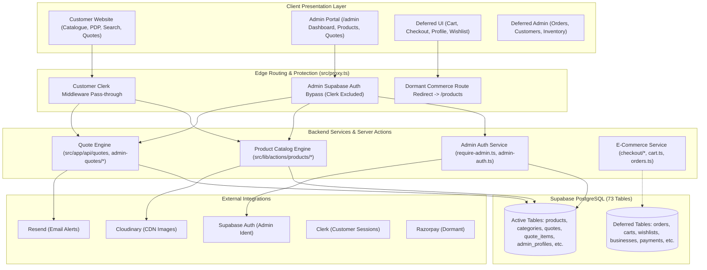

# CEDAR ELEVATORS - PHASE 1 DEPENDENCY MAP
**Document Version:** 1.0  
**Status:** Read-Only Architectural Mapping Complete  
**Objective:** Explicitly trace relationships between active Phase 1 features, deferred Phase 2 modules, backend operations, database tables, and external services to prevent regressions during feature reduction.

---

## 1. System Architectural Overview



---

## 2. Core Customer Quotation Journey Dependency Chain

The Phase 1 quotation journey is the primary commercial workflow of the application:
`Homepage` → `Product Catalogue` → `Category/Search/Filter` → `Product Detail` → `Add to Quote Basket` → `Submit Guest Quote` → `Confirmation & Email Alert`.

### Detailed Trace:
1. **Entry & Discovery**:
   - Component: `src/modules/layout/components/desktop/navbar/index.tsx`, `src/modules/home/components/*`
   - Data Dependency: `banners`, `banner_slides`, `categories`
   - External: Cloudinary media URLs
2. **Product Browsing & Filtering**:
   - Component: `src/app/(main)/catalog/page.tsx`, `src/app/search/page.tsx`
   - APIs: `GET /api/store/products`, `GET /api/store/filters/*`
   - Service: `src/lib/actions/products/search.ts`, `src/lib/actions/products/queries.ts`
   - Data Dependency: `products`, `product_variants`, `categories`, `subcategories`, `applications`, `elevator_types`, `product_categories`
3. **Product Inspection (PDP)**:
   - Component: `src/app/(main)/products/[handle]/page.tsx`
   - Data Dependency: `products` (fields: `id`, `name`, `slug`, `sku`, `specifications`, `dimensions`, `images`, `base_price`), `product_variants`
   - Shared Dependency Warning: PDP originally had both "Add to Cart" and "Request Quote" buttons. "Add to Cart" hooks into `useCart()` (`CartContext`). Disabling cart must NOT break the product data loading or quote addition.
4. **Quotation Basket & Submission**:
   - Component: `src/app/(main)/quotes/new/page.tsx`, `src/modules/quote/components/quote-form.tsx`
   - API: `POST /api/quotes`
   - Data Dependency: `quotes` (insert), `quote_items` (insert), `quote_counters` (sequential ID generator), `quote_audit_log` (insert)
   - Email Trigger: Dispatches quote reception email via Resend (`src/lib/email/quote-notification.ts`).
5. **Confirmation View**:
   - Component: `src/app/(main)/quotes/success/page.tsx`
   - Displays reference number (e.g. `CE-Q-202611-0042`) and next steps.

---

## 3. Core Admin Management Dependency Chain

The Phase 1 admin journey is the administrative fulfillment workflow:
`/admin` → `Supabase Login` → `Dashboard` → `Product/Category Management` → `Quotation Review & Pricing Response`.

### Detailed Trace:
1. **Entry & Authentication**:
   - URL: `http://localhost:3000/admin` (Local) / `https://admin.cedarelevators.com` (Prod)
   - Proxy: `src/proxy.ts` completely bypasses Clerk and refreshes Supabase cookies via `refreshAdminSupabaseSession()`.
   - Layout: `src/app/admin/(dashboard)/layout.tsx` checks `checkAdminSessionAction()`.
   - Security Boundary: `src/lib/auth/require-admin.ts` independently queries `public.admin_profiles` matching `auth.users.id`.
2. **Dashboard Overview**:
   - Component: `src/app/admin/(dashboard)/page.tsx`
   - Action: `src/lib/actions/admin-dashboard.ts` (`getQuickStats`)
   - Data Dependency: Counts from `quotes`, `products`, `categories`.
   - Warning: Originally queried `orders` count. If `orders` is empty, query returns 0 safely, but the card should be hidden or replaced with Quote statistics.
3. **Product & Image Administration**:
   - Component: `src/app/admin/(dashboard)/products/*`
   - APIs: `POST /api/admin/products`, `POST /api/upload-cloudinary`
   - Data Dependency: `products`, `product_variants`, `product_categories`, `product_applications`, `product_elevator_types`
   - External: Cloudinary unsigned/signed upload signatures.
4. **Quotation Review & Proposal**:
   - Component: `src/app/admin/(dashboard)/quotes/[id]/page.tsx`
   - Actions: `src/lib/actions/admin-quotes/*`
   - Data Dependency: `quotes`, `quote_items`, `quote_admin_responses`, `quote_audit_log`
   - Capabilities: Admin enters customized component pricing, bulk discounts, notes, sets status (`approved`, `reviewing`, `rejected`), and dispatches quotation proposal to client.

---

## 4. Critical Shared Dependencies (DO NOT DISABLE)

The following components, tables, and services are shared between Phase 1 and Phase 2. Modifying or removing them will cause immediate regressions:

| Shared Component | Used By Phase 1 (Keep) | Used By Phase 2 (Deferred) | Why It Must NOT Be Disabled |
|---|---|---|---|
| **`products` table** | Product catalogue, PDP, search, quote items | Shopping cart, checkout, orders | Master record of all components; needed for both quotes and sales. |
| **`product_variants` table** | Specification display, specific part numbers | Inventory tracking, SKU fulfillment | Quote items link to `variant_id` for accurate part numbering. |
| **`pricing_settings` table**| B2B price visibility toggles (hide prices for guests) | Tiered wholesale margin calculations | Dictates whether product base prices are visible on the public catalogue. |
| **`inventory_items` table** | Stock availability badges ("In Stock" / "Made to Order") | Inventory deduction, safety stock alerts | Catalogue uses `stock_status` flag to indicate product availability. |
| **`Cloudinary` integration**| Public product imagery, hero carousels | User verification document uploads | All imagery URLs across the entire application resolve through Cloudinary. |
| **`Resend` integration** | Quote submission confirmation, admin recovery | Order confirmation emails, shipping alerts | Transactional email provider for the entire platform. |
| **`store_settings` table** | Contact page, footer, email signatures | Invoice branding, tax registration number | Stores official company name, phone, email, and address. |
| **`ClerkProvider` context** | Root layout provider hierarchy | Customer authentication, profile management | Removing `<ClerkProvider>` from `src/app/layout.tsx` will cause immediate client-side crashes in components referencing `@clerk/nextjs`. |
| **`src/lib/types/domain.ts`**| TypeScript type contracts for Product, Category, Quote | Cart, Order, Customer types | Shared interfaces imported throughout the entire frontend and backend. |

---

## 5. Non-Destructive Deferral Strategy (Phase 2 Isolation)

To achieve Phase 1 simplification without breaking the codebase:

1. **Proxy Protection Layer (`src/proxy.ts`)**:
   - Keep dormant routes intercepted at the edge:
     ```typescript
     const isDormantCommerceRoute = createRouteMatcher([
       '/checkout(.*)',
       '/cart(.*)',
       '/profile(.*)',
       '/wishlist(.*)',
       '/track(.*)',
       '/order-confirmation(.*)',
       '/choose-type(.*)',
       '/individual-signup(.*)',
       '/business-signup(.*)',
     ])
     ```
   - Requests to these URLs immediately redirect with 307/302 to `/products`.
2. **Navigation Pruning**:
   - Desktop Navbar: Remove Cart Hover Card, Wishlist button, and Deliver-To selector. Retain "Request a Quote", "Contact", and "Admin".
   - Mobile Bottom Nav: Already pruned to `Home`, `Catalog`, `Get Quote`, `Contact`.
   - Admin Sidebar: Hide `Orders`, `Customers`, and `Inventory` tabs.
   - Admin Settings: Set `hidden: true` on `shipping`, `payments`, and `tax` modules in `src/lib/admin/settings-access.ts`.
3. **PDP Action Pruning**:
   - Remove "Add to Cart" and "Buy Now" buttons from `src/modules/products/components/product-actions/*`.
   - Make "Request a Quote" the single primary CTA.
4. **Database Preservation**:
   - Zero schema alterations. No tables dropped, no columns deleted, no foreign keys stripped.
   - All 33 deferred tables remain idle, ready for Phase 2 activation.
