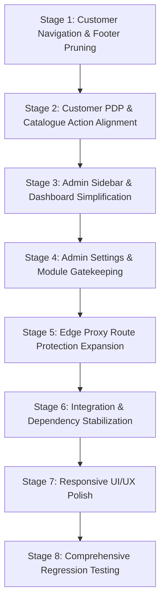

# CEDAR ELEVATORS - PHASE 1 SIMPLIFICATION PLAN
**Document Version:** 1.0  
**Status:** Implementation Blueprint (Awaiting Approval)  
**Methodology:** Non-Destructive Feature Reduction (Prune, Protect & Preserve)  
**Rule:** Zero schema deletion, zero package uninstallation, zero breaking refactors.  

---

## 1. Sequence Overview

---

## 2. Granular Stage Specifications

### Stage 1: Customer Navigation & Footer Simplification
- **Objective**: Eliminate consumer e-commerce distractions from the public desktop and mobile headers, footer, and menus, focusing visitor attention strictly on product discovery and quotation requests.
- **Affected Files**:
  - `src/modules/layout/components/desktop/navbar/components/navbar-actions.tsx`
  - `src/modules/layout/components/desktop/navbar/config.ts`
  - `src/modules/layout/components/desktop/footer/components/quick-links-column.tsx`
  - `src/modules/layout/components/mobile/sidebar/index.tsx`
- **Actions**:
  1. Remove `cart-hover-card.tsx`, `wishlist-hover-card.tsx`, and `deliver-to-menu.tsx` from desktop header actions.
  2. In `quick-links-column.tsx`, remove `/wishlist` ("Saved Items") link; retain "Request Quote" and "All Products".
  3. Ensure mobile bottom nav items remain: `Home`, `Catalog`, `Get Quote`, `Contact`.
- **Dependencies**: Header layouts, Lucide icons.
- **Risks**: Breaking desktop navbar styling or layout collapse if flex spacing is misconfigured.
- **Verification**: Visual inspection across desktop (>1024px) and mobile (<768px). Confirm no cart/wishlist icons appear.

---

### Stage 2: Customer PDP & Catalogue Action Alignment
- **Objective**: Replace all e-commerce transactional actions ("Add to Cart", "Buy Now", price quantity multipliers tied to checkout) with the single Phase 1 commercial action: "Add to Quote" / "Request Quote".
- **Affected Files**:
  - `src/app/(main)/products/[handle]/page.tsx`
  - `src/modules/products/components/product-actions/*`
  - `src/modules/catalog/components/product-card.tsx`
- **Actions**:
  1. On Product Detail Page, hide the "Add to Cart" and "Buy Now" button group.
  2. Promote "Add to Quote" as the primary full-width button. Clicking "Add to Quote" adds the item to the session quotation basket and redirects/prompts to view the quote form at `/quotes/new`.
  3. On Product Catalogue cards, ensure the action link points to the PDP or opens the quote builder directly.
- **Dependencies**: `src/lib/actions/quote-basket.ts` or local session quote storage.
- **Risks**: Uncaught `useCart()` runtime errors if cart context hooks remain unmounted.
- **Verification**: Navigate to PDP of multiple products; verify clicking "Add to Quote" populates the quote form at `/quotes/new` with the correct product name, SKU, and specifications.

---

### Stage 3: Admin Sidebar & Dashboard Simplification
- **Objective**: Cleanse the administrator interface of dormant e-commerce operational modules (Orders, Customers, Inventory) so staff only interact with Quotations, Products, Categories, CMS, and Settings.
- **Affected Files**:
  - `src/components/common/sidebar.tsx`
  - `src/modules/admin/common/sidebar.tsx`
  - `src/app/admin/(dashboard)/page.tsx`
  - `src/lib/actions/admin-dashboard.ts`
- **Actions**:
  1. In `sidebar.tsx`, comment out or filter out:
     - `Orders` (`/admin/orders`)
     - `Customers` (`/admin/customers`)
     - `Inventory` (`/admin/inventory`)
  2. Retain: `Dashboard`, `Quotes`, `Products`, `Applications`, `Categories`, `Elevator Types`, `Collections`, `Banners`, `Settings`.
  3. On `/admin` dashboard overview, update `getQuickStats()` to display:
     - Total Quotes & Pending Review Count
     - Total Active Products
     - Total Categories
     - Recent Quotation Requests feed (replaces Order feed).
- **Dependencies**: `requireAdmin()`, `admin_profiles`, `quotes` table.
- **Risks**: Dashboard widget crash if `getQuickStats()` fails to fetch order count. Gracefully default order stats to null/omitted.
- **Verification**: Log in to `/admin` as administrator; verify sidebar shows only relevant catalogue and quote tools; dashboard widgets render without errors.

---

### Stage 4: Admin Settings & Module Gatekeeping
- **Objective**: Hide retail e-commerce configurations from the admin settings panel (Shipping zones, Payments, Taxes), preserving store identity, CMS, and staff access.
- **Affected Files**:
  - `src/lib/admin/settings-access.ts`
  - `src/modules/admin/settings/settings-sidebar.tsx`
- **Actions**:
  1. In `SETTINGS_MODULES`, set `hidden: true` on modules `shipping`, `payments`, and `tax`.
  2. Retain visible modules: `general` (Store details), `users` (Admin staff), `why-choose-cedar` (CMS), `warranty-info` (CMS), `policies` (CMS).
- **Dependencies**: `admin_settings`, `admin_profiles`.
- **Risks**: None. `settings-access.ts` already has a clean `hidden?: boolean` property natively built into the configuration engine.
- **Verification**: Visit `/admin/settings` as super_admin; verify only General, Admin Users, and CMS sections are visible in the settings sidebar.

---

### Stage 5: Edge Proxy Route Protection Expansion
- **Objective**: Ensure all deferred customer-facing e-commerce routes fail closed and gracefully redirect to `/products`, preventing visitors from stumbling upon orphaned cart or checkout pages.
- **Affected Files**:
  - `src/proxy.ts`
- **Actions**:
  1. Expand `isDormantCommerceRoute` matcher to include:
     - `/cart(.*)`
     - `/checkout(.*)`
     - `/profile(.*)`
     - `/wishlist(.*)`
     - `/track(.*)`
     - `/order-confirmation(.*)`
     - `/choose-type(.*)`
     - `/individual-signup(.*)`
     - `/business-signup(.*)`
  2. Maintain 307 redirect directly to `/products`.
  3. Maintain strict exact hostname matching for `ADMIN_DOMAIN` and `admin.localhost`.
- **Dependencies**: Next.js Edge runtime, `clerkMiddleware`.
- **Risks**: Infinite redirect loops if `/products` were inadvertently included (already excluded).
- **Verification**: Run `node --env-file=.env scratch/test-proxy-simulation.mjs` verifying all dormant routes redirect to `/products`.

---

### Stage 6: Integration & Dependency Stabilization
- **Objective**: Safeguard external API connections without deleting packages or breaking build dependencies.
- **Affected Files**:
  - None (Preservation-only stage).
- **Actions**:
  1. Retain `@clerk/nextjs`, `@supabase/ssr`, `cloudinary`, `resend`, `razorpay`, `upstash/redis` in `package.json`.
  2. Silence any unused cron jobs or WebSocket listeners that might log warnings if external API keys are omitted in development.
- **Dependencies**: `package.json`, environment variables.
- **Risks**: Accidental package uninstallation breaking type definitions.
- **Verification**: Run `pnpm tsc --noEmit` to confirm zero compilation errors.

---

### Stage 7: Responsive UI/UX Polish
- **Objective**: Ensure mobile and desktop experiences feel complete, cohesive, and intentional as a commercial B2B catalogue.
- **Affected Files**:
  - `src/modules/layout/components/mobile/bottom-nav/index.tsx`
  - `src/modules/home/components/mobile/sections/hero-guest.tsx`
  - `src/modules/quote/components/quote-form.tsx`
- **Actions**:
  1. Verify mobile touch targets (minimum 44x44px).
  2. Ensure quote success page displays WhatsApp contact button and direct phone call links for immediate customer follow-up.
  3. Ensure quotation request badge counter updates accurately when items are added.
- **Dependencies**: Tailwind CSS, Lucide icons.
- **Risks**: Mobile CSS overflow or fixed bottom nav obscuring form submit buttons.
- **Verification**: Test on iPhone, iPad, and desktop viewports in Chrome DevTools.

---

### Stage 8: Comprehensive Regression Testing
- **Objective**: Formally execute all test cases in `CEDAR_ELEVATORS_PHASE1_REGRESSION_CHECKLIST.md`.
- **Scope**:
  - Customer catalogue browsing, search, facet filtering, PDP specs.
  - Guest quote submission, validation, and confirmation.
  - Admin login, session persistence, product editing, and quote pricing management.
  - Negative tests (confirming cart, checkout, profile routes redirect cleanly).
