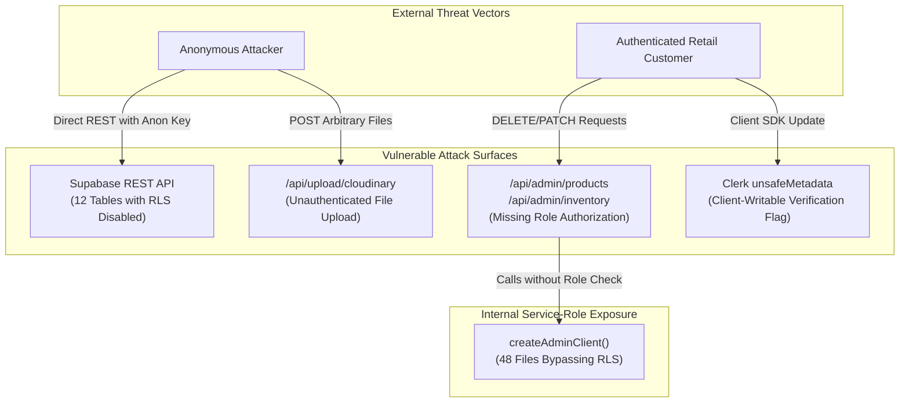

# CEDAR ELEVATORS — SECURITY REMEDIATION PLAN

**Document Version:** 1.0 (Detailed Security Architecture & Hardening Blueprint)  
**Date:** November 19, 2026  
**Status:** Approved for Implementation Planning  
**Target Environment:** Clerk Native JWT Integration + Supabase PostgreSQL 17 (`hbkdbrxzqaraarivudej`)  
**Threat Model:** Public Internet Exposure, Anonymous REST API Scanning, Privilege Escalation via Customer Sessions, Cloud Storage Abuse.

---

## 1. THREAT MODEL & SECURITY BASELINE

The Cedar Elevators application is a hybrid Next.js e-commerce architecture running both customer-facing storefront pages and administrative dashboards. The initial audit and revalidation identified four critical threat vectors:

1. **Anonymous Supabase REST Exploitation:** Because 12 public tables lack Row Level Security (RLS), anyone with the public Supabase Anon key can issue direct REST queries against `https://hbkdbrxzqaraarivudej.supabase.co/rest/v1/` to read customer emails, phone numbers, or modify category data.
2. **Horizontal & Vertical Privilege Escalation in Admin APIs:** Admin endpoints check `const { userId } = await auth()` from Clerk without checking administrative roles (`// TODO: Add admin role check`). Any authenticated storefront customer can trigger admin deletion or modification operations.
3. **Bypass of RLS via Service-Role Key:** 48 server files instantiate `createAdminClient()`, which uses `SUPABASE_SERVICE_ROLE_KEY`. Because the service-role key unconditionally bypasses all Postgres RLS policies, RLS alone does NOT protect these operations.
4. **Unrestricted Cloud Storage Consumption:** Multiple unauthenticated API endpoints accept arbitrary base64 and multipart file payloads, uploading directly to Cloudinary using master server credentials.



---

## 2. ROW LEVEL SECURITY (RLS) REMEDIATION

### 2.1 The 12 Exposed Tables
Supabase security advisors confirmed that RLS is currently **DISABLED** on:
1. `public.users`
2. `public.categories`
3. `public.subcategories`
4. `public.product_applications`
5. `public.quote_counters`
6. `public.carts`
7. `public.cart_items`
8. `public.addresses`
9. `public.customer_profiles`
10. `public.product_variants`
11. `public.product_specifications`
12. `public.business_verifications`

### 2.2 Complete Remediation SQL Script

The following non-destructive migration script enables RLS on all 12 tables and defines explicit, role-scoped policies:

```sql
-- ====================================================================
-- CEDAR ELEVATORS - PHASE 1 RLS HARDENING MIGRATION
-- Migration Version: 20260122000001_harden_rls_policies.sql
-- ====================================================================

BEGIN;

-- 1. Enable RLS on all exposed tables
ALTER TABLE public.users ENABLE ROW LEVEL SECURITY;
ALTER TABLE public.categories ENABLE ROW LEVEL SECURITY;
ALTER TABLE public.subcategories ENABLE ROW LEVEL SECURITY;
ALTER TABLE public.product_applications ENABLE ROW LEVEL SECURITY;
ALTER TABLE public.quote_counters ENABLE ROW LEVEL SECURITY;
ALTER TABLE public.carts ENABLE ROW LEVEL SECURITY;
ALTER TABLE public.cart_items ENABLE ROW LEVEL SECURITY;
ALTER TABLE public.addresses ENABLE ROW LEVEL SECURITY;
ALTER TABLE public.customer_profiles ENABLE ROW LEVEL SECURITY;
ALTER TABLE public.product_variants ENABLE ROW LEVEL SECURITY;
ALTER TABLE public.product_specifications ENABLE ROW LEVEL SECURITY;
ALTER TABLE public.business_verifications ENABLE ROW LEVEL SECURITY;

-- --------------------------------------------------------------------
-- 2. PUBLIC CATALOG TABLES (Read-only to public/anon, Write to Service Role)
-- --------------------------------------------------------------------

-- Categories
DROP POLICY IF EXISTS "Public can view categories" ON public.categories;
CREATE POLICY "Public can view categories" ON public.categories
    FOR SELECT TO public USING (true);

-- Subcategories
DROP POLICY IF EXISTS "Public can view subcategories" ON public.subcategories;
CREATE POLICY "Public can view subcategories" ON public.subcategories
    FOR SELECT TO public USING (true);

-- Product Applications
DROP POLICY IF EXISTS "Public can view product_applications" ON public.product_applications;
CREATE POLICY "Public can view product_applications" ON public.product_applications
    FOR SELECT TO public USING (true);

-- Product Variants
DROP POLICY IF EXISTS "Public can view product_variants" ON public.product_variants;
CREATE POLICY "Public can view product_variants" ON public.product_variants
    FOR SELECT TO public USING (true);

-- Product Specifications
DROP POLICY IF EXISTS "Public can view product_specifications" ON public.product_specifications;
CREATE POLICY "Public can view product_specifications" ON public.product_specifications
    FOR SELECT TO public USING (true);

-- --------------------------------------------------------------------
-- 3. CUSTOMER DATA TABLES (Owner-scoped access via Clerk JWT)
-- --------------------------------------------------------------------

-- Users Table (Stores mapped Clerk user info)
DROP POLICY IF EXISTS "Users view own record" ON public.users;
CREATE POLICY "Users view own record" ON public.users
    FOR SELECT TO authenticated
    USING (clerk_user_id = (auth.jwt() ->> 'sub'));

DROP POLICY IF EXISTS "Users update own record" ON public.users;
CREATE POLICY "Users update own record" ON public.users
    FOR UPDATE TO authenticated
    USING (clerk_user_id = (auth.jwt() ->> 'sub'))
    WITH CHECK (clerk_user_id = (auth.jwt() ->> 'sub'));

-- Customer Addresses
DROP POLICY IF EXISTS "Users view own addresses" ON public.addresses;
CREATE POLICY "Users view own addresses" ON public.addresses
    FOR SELECT TO authenticated
    USING (user_id = (auth.jwt() ->> 'sub'));

DROP POLICY IF EXISTS "Users modify own addresses" ON public.addresses;
CREATE POLICY "Users modify own addresses" ON public.addresses
    FOR ALL TO authenticated
    USING (user_id = (auth.jwt() ->> 'sub'))
    WITH CHECK (user_id = (auth.jwt() ->> 'sub'));

-- Customer Profiles
DROP POLICY IF EXISTS "Users view own customer_profile" ON public.customer_profiles;
CREATE POLICY "Users view own customer_profile" ON public.customer_profiles
    FOR SELECT TO authenticated
    USING (clerk_user_id = (auth.jwt() ->> 'sub'));

DROP POLICY IF EXISTS "Users update own customer_profile" ON public.customer_profiles;
CREATE POLICY "Users update own customer_profile" ON public.customer_profiles
    FOR UPDATE TO authenticated
    USING (clerk_user_id = (auth.jwt() ->> 'sub'))
    WITH CHECK (clerk_user_id = (auth.jwt() ->> 'sub'));

-- Carts & Cart Items (Owner-scoped)
DROP POLICY IF EXISTS "Users view own cart" ON public.carts;
CREATE POLICY "Users view own cart" ON public.carts
    FOR SELECT TO authenticated
    USING (clerk_user_id = (auth.jwt() ->> 'sub'));

DROP POLICY IF EXISTS "Users modify own cart" ON public.carts;
CREATE POLICY "Users modify own cart" ON public.carts
    FOR ALL TO authenticated
    USING (clerk_user_id = (auth.jwt() ->> 'sub'))
    WITH CHECK (clerk_user_id = (auth.jwt() ->> 'sub'));

DROP POLICY IF EXISTS "Users view own cart items" ON public.cart_items;
CREATE POLICY "Users view own cart items" ON public.cart_items
    FOR SELECT TO authenticated
    USING (cart_id IN (SELECT id FROM public.carts WHERE clerk_user_id = (auth.jwt() ->> 'sub')));

DROP POLICY IF EXISTS "Users modify own cart items" ON public.cart_items;
CREATE POLICY "Users modify own cart items" ON public.cart_items
    FOR ALL TO authenticated
    USING (cart_id IN (SELECT id FROM public.carts WHERE clerk_user_id = (auth.jwt() ->> 'sub')))
    WITH CHECK (cart_id IN (SELECT id FROM public.carts WHERE clerk_user_id = (auth.jwt() ->> 'sub')));

-- Business Verifications
DROP POLICY IF EXISTS "Users view own verifications" ON public.business_verifications;
CREATE POLICY "Users view own verifications" ON public.business_verifications
    FOR SELECT TO authenticated
    USING (clerk_user_id = (auth.jwt() ->> 'sub'));

-- Quote Counters (Internal system sequence - restrict completely from public REST)
DROP POLICY IF EXISTS "Restrict quote_counters to service_role" ON public.quote_counters;
-- No public policies created for quote_counters; service-role access only.

COMMIT;
```

---

## 3. ADMIN API AUTHORIZATION & SERVICE-ROLE CONTAINMENT

### 3.1 The Service-Role Problem
The application contains **48 files that instantiate `createAdminClient()`**.  
* `createAdminClient()` uses `process.env.SUPABASE_SERVICE_ROLE_KEY`.
* In PostgreSQL, requests authenticated with `service_role` execute with the database role `service_role`, which possesses the `BYPASSRLS` attribute.
* **Key Principle:** Postgres RLS provides zero defense against malicious or unauthorized calls to functions that internally call `createAdminClient()`. Security must be enforced at the Next.js API / Server Action layer before invoking `createAdminClient()`.

### 3.2 Trusted Admin Authorization Middleware (`src/lib/auth/require-admin.ts`)

Create a unified authorization utility that verifies the caller's session against the `public.admin_users` table in Supabase:

```typescript
// src/lib/auth/require-admin.ts
import { auth, currentUser } from '@clerk/nextjs/server'
import { createServerSupabase, createAdminClient } from '@/lib/supabase/server'
import { NextResponse } from 'next/server'
import type { NextRequest } from 'next/server'

export type AllowedAdminRole = 'staff' | 'manager' | 'admin' | 'super_admin'

const ROLE_RANKS: Record<AllowedAdminRole, number> = {
  staff: 1,
  manager: 2,
  admin: 3,
  super_admin: 4,
}

export interface AuthenticatedAdmin {
  id: string
  email: string
  role: AllowedAdminRole
  source: 'supabase_auth' | 'clerk_auth'
}

/**
 * Validates whether the current request is issued by an active administrator.
 * Supports both Supabase Auth cookie session (Admin Panel) and Clerk Session (with Admin Email match).
 */
export async function requireAdmin(
  minRole: AllowedAdminRole = 'staff'
): Promise<AuthenticatedAdmin> {
  // 1. Check Supabase Auth session (Primary Admin Panel authentication)
  try {
    const supabase = await createServerSupabase()
    const { data: { user: supabaseUser } } = await supabase.auth.getUser()

    if (supabaseUser && supabaseUser.email) {
      const adminDb = createAdminClient()
      const { data: adminRecord } = await adminDb
        .from('admin_users')
        .select('id, email, role, is_active')
        .eq('email', supabaseUser.email)
        .eq('is_active', true)
        .single()

      if (adminRecord && ROLE_RANKS[adminRecord.role as AllowedAdminRole] >= ROLE_RANKS[minRole]) {
        return {
          id: adminRecord.id,
          email: adminRecord.email,
          role: adminRecord.role as AllowedAdminRole,
          source: 'supabase_auth',
        }
      }
    }
  } catch (err) {
    // Supabase auth check failed or cookie absent, proceed to Clerk check
  }

  // 2. Check Clerk Session (Secondary / unified check)
  const clerkAuth = await auth()
  if (clerkAuth.userId) {
    const clerkUser = await currentUser()
    const primaryEmail = clerkUser?.emailAddresses?.[0]?.emailAddress

    if (primaryEmail) {
      const adminDb = createAdminClient()
      const { data: adminRecord } = await adminDb
        .from('admin_users')
        .select('id, email, role, is_active')
        .eq('email', primaryEmail)
        .eq('is_active', true)
        .single()

      if (adminRecord && ROLE_RANKS[adminRecord.role as AllowedAdminRole] >= ROLE_RANKS[minRole]) {
        return {
          id: adminRecord.id,
          email: adminRecord.email,
          role: adminRecord.role as AllowedAdminRole,
          source: 'clerk_auth',
        }
      }
    }
  }

  // 3. Reject request if no valid admin role found
  throw new Error('Forbidden: Insufficient administrative privileges.')
}
```

### 3.3 Patching Vulnerable Admin Route Handlers
All `/api/admin/*` endpoints must be updated to enforce `requireAdmin`. For example:

#### Patch `src/app/api/admin/products/route.ts`:
```typescript
// Replace existing lines 17-23, 57-63, 136-142 with:
import { requireAdmin } from '@/lib/auth/require-admin'

export async function DELETE(request: NextRequest) {
  try {
    // Enforce administrative role (manager or above)
    await requireAdmin('manager')

    const { productIds } = await request.json()
    if (!productIds || !Array.isArray(productIds) || productIds.length === 0) {
      return NextResponse.json({ error: 'Product IDs array is required' }, { status: 400 })
    }

    const result = await bulkDeleteProducts(productIds)
    if (!result.success) {
      return NextResponse.json({ error: result.error }, { status: 500 })
    }

    return NextResponse.json({ success: true, message: `Deleted ${productIds.length} products` })
  } catch (error: any) {
    if (error.message.includes('Forbidden')) {
      return NextResponse.json({ error: error.message }, { status: 403 })
    }
    return NextResponse.json({ error: 'Failed to delete products' }, { status: 500 })
  }
}
```

#### Patch `src/app/api/admin/inventory/route.ts`:
```typescript
// In PATCH handler (line 141), replace:
// const { userId } = await auth()
// with:
await requireAdmin('manager')
```

---

## 4. CLOUDINARY UPLOAD ENDPOINT HARDENING

### 4.1 Vulnerability Diagnosis
1. `src/app/api/upload/cloudinary/route.ts`: Completely unauthenticated, accepts arbitrary base64 payloads, allows client to specify any folder, no MIME type or size limits.
2. `src/app/api/upload-cloudinary/route.ts`: Redundant unauthenticated duplicate endpoint accepting multiple files.

### 4.2 Remediation Blueprint
1. **Delete Redundant Endpoint:** Remove `src/app/api/upload-cloudinary/route.ts`. Point all callers to `/api/upload/cloudinary`.
2. **Harden `src/app/api/upload/cloudinary/route.ts`:**
   - Require Clerk authentication (`const { userId } = await auth()`).
   - Restrict allowed MIME types: `image/jpeg`, `image/png`, `image/webp`, `application/pdf`.
   - Max file size: 10MB (`10 * 1024 * 1024` bytes).
   - Sanitize upload folder to whitelist: `['quote_attachments', 'product_images', 'verifications']`. Reject arbitrary paths.
   - Use Cloudinary server-side upload presets with transformations enabled (`fetch_format: 'auto'`, `quality: 'auto:good'`).

---

## 5. CLERK METADATA TAMPERING DEFENSE

### 5.1 Analysis of Client `unsafeMetadata`
In Clerk, `user.unsafeMetadata` is writable from the client browser using `user.update({ unsafeMetadata: { ... } })`.  
* **Flaw Identified:** Storefront components (`src/app/(main)/quotes/new/page.tsx` line 47) read `user?.unsafeMetadata?.is_verified === true` to set the user tier to `verified`.
* **Impact:** While catalog pricing cannot be modified, this sets `priority = 'urgent'` on the resulting quote and alters UI badges.

### 5.2 Server-Side Hardening
1. **Never trust `unsafeMetadata` for access decisions:** Verification status must only be read from:
   - The PostgreSQL `public.business_verifications` table (where `status = 'approved'`), OR
   - Clerk's server-managed `user.publicMetadata` (which can only be written by the backend using `CLERK_SECRET_KEY`).
2. **Quote Priority Sanitization:** In `src/lib/actions/quotes.ts`, compute priority strictly from verified database records:
   ```typescript
   // Verify directly against database, ignoring client claims
   const { data: verification } = await supabase
     .from('business_verifications')
     .select('status')
     .eq('clerk_user_id', userId)
     .eq('status', 'approved')
     .single()

   const isVerifiedBusiness = Boolean(verification)
   const priority = isVerifiedBusiness ? 'high' : 'normal'
   ```

---

## 6. RATE LIMITING & INPUT VALIDATION

### 6.1 Upstash Redis Rate Limiting
The project already includes `@upstash/redis` in `package.json` and credentials in `.env`:
* `UPSTASH_REDIS_REST_URL`
* `UPSTASH_REDIS_REST_TOKEN`

### 6.2 Rate Limit Configuration
Implement IP-based rate limiting on sensitive public endpoints:
1. **Quotation Submission (`/api/quotes/new` & `createQuote`):** Max **5 requests per 10 minutes** per IP to prevent quote spam.
2. **File Uploads (`/api/upload/cloudinary`):** Max **10 uploads per hour** per authenticated user.
3. **Admin Login (`/api/admin/login`):** Max **5 attempts per 15 minutes** per IP to block brute-force credential stuffing.

---

## 7. ENVIRONMENT VARIABLES & SECRETS AUDITING

| Variable Name | Exposure Scope | Verification Rule | Action Required |
| :--- | :--- | :--- | :--- |
| `NEXT_PUBLIC_SUPABASE_URL` | Client & Server | Verified safe | Retain as public. |
| `NEXT_PUBLIC_SUPABASE_ANON_KEY` | Client & Server | Verified safe | Retain as public; protected by RLS. |
| `SUPABASE_SERVICE_ROLE_KEY` | **Server ONLY** | Verified server-only | Ensure never prefixed with `NEXT_PUBLIC_`. |
| `NEXT_PUBLIC_CLERK_PUBLISHABLE_KEY` | Client & Server | Verified safe | Retain as public. |
| `CLERK_SECRET_KEY` | **Server ONLY** | Verified server-only | Keep strictly on server. |
| `CLOUDINARY_URL` | **Server ONLY** | Verified server-only | Keep strictly on server. |
| `CRON_SECRET` | **Server ONLY** | Verified server-only | Used to authorize Vercel Cron calls via Bearer token. |
| `NEXT_PUBLIC_APP_URL` | Client & Server | Verified safe | Set to production domain (`https://www.cedarelevators.com`). |

---

## 8. SECURITY VERIFICATION & REGRESSION TESTING

Before declaring Phase 1 launch-ready, execute the following security verification tests:

| Test Case | Method | Expected Result | Pass Criteria |
| :--- | :--- | :--- | :--- |
| **RLS Anon Isolation** | `curl -H "apikey: $ANON_KEY" https://hbkdbrxzqaraarivudej.supabase.co/rest/v1/users` | HTTP 200 with empty array `[]` or HTTP 401. | No user data returned. |
| **Catalog Public Read** | `curl -H "apikey: $ANON_KEY" https://hbkdbrxzqaraarivudej.supabase.co/rest/v1/products?select=id,name` | HTTP 200 with product list. | Products remain readable by public. |
| **Admin Route Protection** | Send `DELETE /api/admin/products` with valid customer Clerk token. | HTTP 403 Forbidden (`Insufficient administrative privileges`). | Non-admin blocked from deletion. |
| **Unauth Upload Block** | Send `POST /api/upload/cloudinary` with no auth header. | HTTP 401 Unauthorized. | Anonymous upload rejected. |
| **Malicious File Block** | Send `POST /api/upload/cloudinary` with `.exe` or `.sh` file. | HTTP 400 Bad Request (`Invalid file type`). | Executable file rejected. |
| **Cron Auth Protection** | Send `GET /api/cron/quotes/expiry` without Bearer token. | HTTP 401 Unauthorized. | Unauthenticated cron trigger rejected. |
